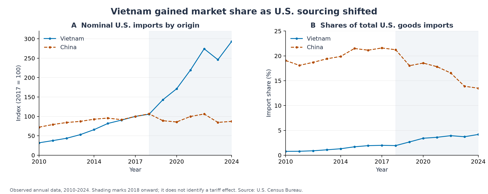

# CES-Based Analysis of Tariff Shocks and Trade Reallocation

[简体中文](README.zh-CN.md)

**Evidence from Vietnam, 2010-2024**

This research report combines a verified 2010-2024 trade series, a symmetric growth decomposition, and a transparent three-origin import-demand model. It examines how Vietnam can gain market access during trade fragmentation while remaining exposed to production costs, policy reversal, and limited domestic value capture.



## Main findings

| Evidence | Result | Interpretation |
|---|---|---|
| Historical data | U.S. goods imports from Vietnam rose from **USD 46.48bn to USD 136.32bn** between 2017 and 2024 | Nominal expansion of **193.30%**, or **16.62%** annually |
| Market position | Vietnam's U.S. import share rose from **1.99% to 4.18%**; China's fell from **21.59% to 13.49%** | A change in sourcing composition; aggregate data do not identify its causes |
| Growth accounting | **USD 61.36bn**, or **68.30%**, of Vietnam's increase is the symmetric share-shift component | An accounting decomposition, not a tariff treatment effect |
| Illustrative model | A 25% China tariff raises Vietnam customs receipts by **11.78%** at elasticity 4 and 2017 weights | A conditional comparative-static result, not a historical estimate |
| Cost sensitivity | A **3.86%** Vietnam cost increase eliminates that modeled receipt gain | Benefits depend on relative costs and competing suppliers |

The analytical conclusion is conditional: export reallocation can create opportunities, but gross shipments alone cannot establish higher productivity, greater domestic income, tariff circumvention, or global welfare gains.

## Read the study

- [Research report](docs/en/report.md): question, evidence, interpretation, investment mechanisms, and cooperation implications.
- [Methods and mathematical derivation](docs/en/methods.md): data definitions, decomposition, CES allocation, fiscal accounting, and the cost threshold.
- [Evidence audit](docs/en/evidence-audit.md): numerical reconciliations and corrections to unsupported arguments in the supplied material.
- [Reproduction and data dictionary](docs/en/reproducibility.md): commands, output definitions, and verification limits.
- [References](references/references.md): primary data, theory, institutional evidence, and related empirical research.

## Analytical artifacts

The repository contains **45 annual partner-year observations**, **288 parameterized import allocations**, and **864 scenario records** after adding three assumed domestic value-added shares. Four figures are provided in PNG and editable SVG. All numerical analysis runs offline from the archived extract.

| Path | Purpose |
|---|---|
| `data/raw/` | Annual Census table extract and source manifest |
| `config/scenarios.json` | Explicit, editable assumptions |
| `src/trade_model.py` | Dependency-free CES allocation model |
| `scripts/` | Data analysis, figures, and validation |
| `results/` | Annual indicators, decomposition, scenario grid, summary, validation record |
| `figures/` | Observed evidence and illustrative sensitivity plots |
| `docs/en/`, `docs/zh-CN/` | Separate, aligned English and Chinese research documentation |

## Reproduce

Python 3.12 is the tested interpreter. From this repository's root:

```sh
python -m venv .venv
# Activate the environment using the command appropriate to your shell.
python -m pip install -r requirements.txt
python scripts/reproduce.py
```

The numerical tables and model tests use only Python's standard library:

```sh
python scripts/analyze.py
python -m unittest discover -s tests -v
python scripts/validate.py
```

## Scope and provenance

This is a descriptive study with an implemented scenario analysis. It does not estimate a causal tariff effect or a general-equilibrium welfare effect. The historical window ends in 2024; the Census extract was retrieved on **6 November 2026** and includes subsequent revisions. Scenario tariff rates are hypothetical wedges relative to a normalized benchmark, not a reconstruction of statutory tariff schedules.

The supplied PDF established the research topic and initial arguments. The public project replaces conflicting statistics and unverified claims with traceable evidence; the original PDF remains outside the published files. See the [evidence audit](docs/en/evidence-audit.md). Third-party data and references retain their source attribution; no blanket license is asserted over external material.
