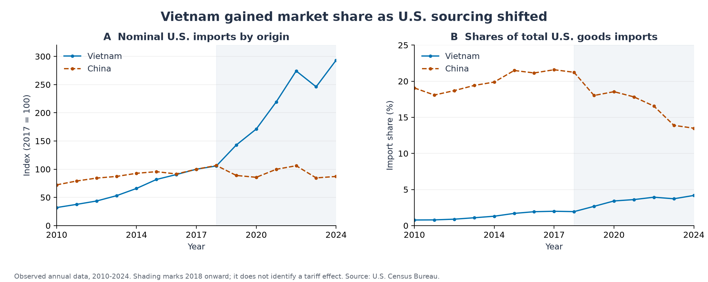

# 基于 CES 需求系统的关税冲击与贸易重配分析

[English](README.md)

**越南案例，2010—2024 年**

本研究将经核对的 2010—2024 年贸易序列、对称增长分解和三来源进口需求模型结合起来，考察越南如何在贸易碎片化中获得市场机会，以及生产成本、政策逆转和国内价值获取能力如何限制这些机会。



## 主要结果

| 证据类型 | 结果 | 解释范围 |
|---|---|---|
| 历史数据 | 2017—2024 年美国自越南商品进口从 **464.8 亿美元增至 1,363.2 亿美元** | 名义累计增长 **193.30%**，年复合增长 **16.62%** |
| 市场地位 | 越南占美国商品进口份额从 **1.99% 升至 4.18%**；中国从 **21.59% 降至 13.49%** | 表明采购来源结构变化，汇总数据无法识别原因 |
| 增长核算 | 越南进口增长中 **613.6 亿美元，即 68.30%** 对应对称分解中的份额变化项 | 属于会计分解，不是关税处理效应 |
| 示意模型 | 在 2017 年权重和替代弹性为 4 时，对中国征收 25% 的假设关税使越南海关价值收入增加 **11.78%** | 有条件的比较静态结果，不是历史估计 |
| 成本敏感性 | 越南成本增加 **3.86%** 即可抵消上述模型收益 | 机会取决于相对成本及其他供应者的竞争 |

研究的核心判断具有条件性：出口重配能够创造机会，但出口总额不能单独证明生产率提升、国内收入增长、关税规避或全球福利改善。

## 阅读路径

- [研究报告](docs/zh-CN/report.md)：研究问题、证据、解释、投资机制及国际合作含义。
- [方法与数学推导](docs/zh-CN/methods.md)：数据口径、增长分解、CES 配置、关税核算和成本阈值。
- [证据审计](docs/zh-CN/evidence-audit.md)：原材料中的数值冲突与缺乏依据的推论及其修正。
- [复现说明与数据字典](docs/zh-CN/reproducibility.md)：运行命令、输出定义及核验边界。
- [参考来源](references/references.zh-CN.md)：原始数据、理论、机构证据及相关实证研究。

## 分析材料

项目包含 **45 条国家（地区汇总）—年份观测**、**288 组参数化进口配置**，并在三个国内增加值比例假设下形成 **864 条情景记录**。四幅图均提供 PNG 和可编辑 SVG 版本。全部数值分析可使用归档数据离线运行。

| 目录 | 内容 |
|---|---|
| `data/raw/` | Census 年度表格提取及来源清单 |
| `config/scenarios.json` | 可修改、明确列示的参数假设 |
| `src/trade_model.py` | 仅依赖 Python 标准库的 CES 模型 |
| `scripts/` | 数据分析、绘图与核验脚本 |
| `results/` | 年度指标、增长分解、情景表、摘要与核验记录 |
| `figures/` | 历史数据图与示意性敏感性分析图 |
| `docs/en/`、`docs/zh-CN/` | 分开编排、结论一致的英文和中文文档 |

## 复现

已使用 Python 3.12 运行。在仓库根目录执行：

```sh
python -m venv .venv
# 按当前终端的要求激活虚拟环境。
python -m pip install -r requirements.txt
python scripts/reproduce.py
```

数值表格与模型测试仅使用标准库：

```sh
python scripts/analyze.py
python -m unittest discover -s tests -v
python scripts/validate.py
```

## 范围与来源

本项目属于描述性研究及已实现的情景分析，没有估计关税的因果效应或一般均衡福利效应。历史窗口截至 2024 年；Census 数据于 **2026 年 11 月 6 日**提取，包含此后的历史修订。情景关税是相对于标准化基准的假设价格楔子，并非实际法定税表的重建。

所提供的 PDF 确定了研究主题和初始论点。公开项目以可追溯证据替换相互冲突的数据和未经核实的结论；原 PDF 未纳入公开文件。详见[证据审计](docs/zh-CN/evidence-audit.md)。外部数据与文献保留来源标注，不对第三方材料宣称统一授权。
