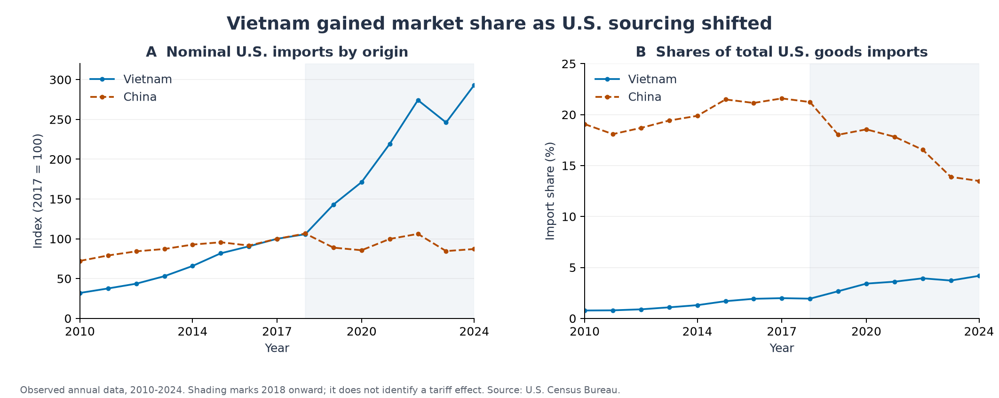
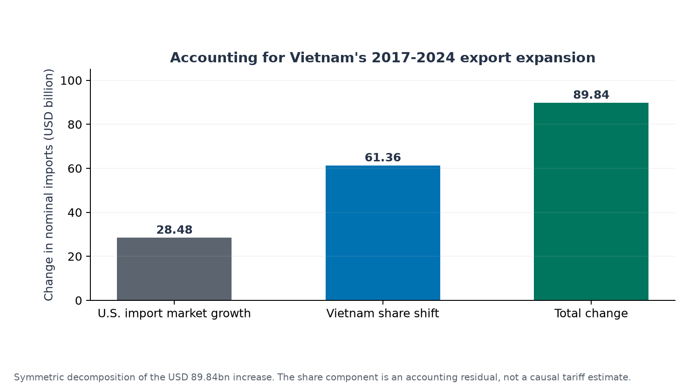
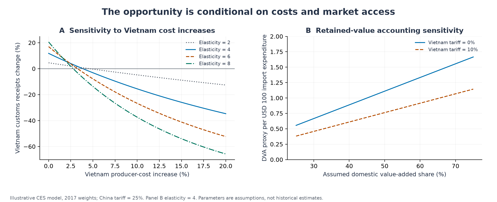
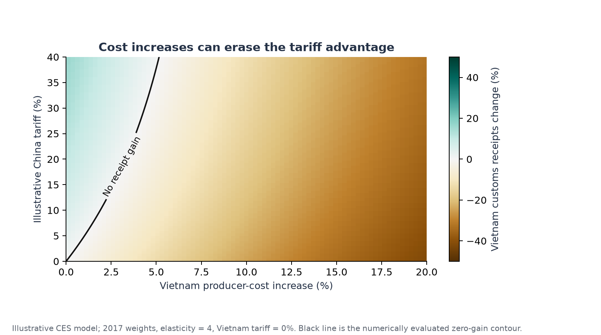

# Trade Reallocation and Domestic Value Capture in Vietnam

[中文版本](../zh-CN/report.md) · [Methods](methods.md) · [Evidence audit](evidence-audit.md)

## Abstract

Vietnam's export expansion during U.S.-China trade tensions raises a development question: when does a change in sourcing translate into durable domestic value creation? This study constructs a consistent annual U.S. goods-trade series for Vietnam, China, and the world over 2010-2024. U.S. imports from Vietnam increased from USD 46.48 billion in 2017 to USD 136.32 billion in 2024, while Vietnam's import share rose by 2.19 percentage points. A symmetric decomposition assigns USD 28.48 billion of the increase to U.S. import-market expansion and USD 61.36 billion to Vietnam's changing share. These are accounting results. A three-origin constant-elasticity-of-substitution model then isolates the relative-price mechanism under explicitly hypothetical assumptions. With 2017 weights, elasticity 4, and a 25% tariff on China, Vietnam's customs receipts rise by 11.78%, but a 3.86% increase in Vietnam's producer costs eliminates this gain. Gross shipment growth therefore provides an incomplete development metric. Domestic supplier links, productive investment, market diversification, and transparent origin administration determine how opportunities can support longer-term upgrading and cooperation.

## 1. Research question and analytical position

Trade restrictions directed at a large supplier can redirect purchasing toward other economies. A third-country exporter may gain even while importing consumers face higher prices and international production becomes more fragmented. These effects must be assessed at different levels: bilateral trade, domestic income, and global resource allocation.

This report asks three linked questions. First, how large was Vietnam's observed expansion relative to the overall U.S. import market? Second, under what cost and market-access conditions does a tariff against China increase Vietnam's receipts? Third, which additional evidence is needed to connect these gains to industrial upgrading and SDG 17?

The study is descriptive and mechanism based. It does not identify a treatment effect. Its contribution is an integrated, auditable separation of observed reallocation, arithmetic decomposition, and conditional model implications. The historical window remains 2010-2024 even though the source pages now contain later observations. This avoids conflating the original episode with later policy regimes.

## 2. Economic mechanisms and related evidence

The [USTR Section 301 action archive](https://ustr.gov/issue-areas/enforcement/section-301-investigations/tariff-actions) establishes the relevant policy setting. A tariff changes the importing buyer's relative price; it does not by itself alter the exporting country's underlying technology or factor endowment. Tariff-induced sourcing and comparative advantage may overlap, but they are different concepts.

[Choi and Nguyen (2023)](https://doi.org/10.1111/1468-0106.12435) examine trade diversion to Vietnam using more disaggregated evidence. [Dang, Krishna, and Zhao (2023)](https://www.nber.org/papers/w31922) also investigate third-country responses and product heterogeneity. Their research motivates a relative-price channel; this repository does not replicate their identification strategies or import their estimated coefficients.

Four mechanisms can operate simultaneously. Buyers may switch suppliers without moving factories. Firms may expand existing Vietnamese plants. New investment may establish additional productive capacity. Goods may also be rerouted, with lawful origin determination depending on the actual production process and applicable rules. Aggregate bilateral totals cannot measure the proportions of these mechanisms or establish unlawful conduct.

The factor-endowment perspective helps organize hypotheses about labor-intensive production and assembly tasks. However, electronics exports are not a direct measure of domestic technological sophistication. Capital intensity, imported components, task content, and firm productivity require separate measurement. Gross capital formation is an investment flow and cannot substitute for a capital-stock-per-worker measure.

## 3. Data and descriptive design

The dataset contains annual U.S. exports, imports, and balances for Vietnam, China, and all countries, giving 45 partner-year rows. The [Census Vietnam](https://www.census.gov/foreign-trade/balance/c5520.html), [China](https://www.census.gov/foreign-trade/balance/c5700.html), and [world](https://www.census.gov/foreign-trade/balance/c0015.html) tables use nominal million U.S. dollars and non-seasonally-adjusted goods data. Annual TOTAL rows were extracted on 6 November 2026. The archive is an extract of rendered table rows, not a complete HTML mirror.

American imports from Vietnam are consistently used throughout. They should not be silently spliced with Vietnam-reported exports, which may differ in valuation, timing, coverage, and attribution. The remainder-of-world series subtracts Vietnam and China from the world total; it is an accounting aggregate rather than a homogeneous observed supplier.

The descriptive design uses a 2017 pre-escalation anchor, shows earlier years, and preserves the 2023 contraction. It does not select only growth years. All prices remain nominal; expenditure changes may reflect inflation, composition, quantities, and exchange-rate movements.

## 4. Observed trade reallocation

Between 2017 and 2024, imports from Vietnam increased by USD 89.84 billion, or 193.30%. Their annual compound growth rate was 16.62%. Vietnam's share of U.S. goods imports increased from 1.99% to 4.18%, while China's share decreased from 21.59% to 13.49%. These shifts are consistent with reallocation toward Vietnam, but they do not establish one-for-one replacement of Chinese production.

Vietnam's expansion also predates 2018. A comparison that treats its entire subsequent increase as a new tariff benefit would omit the earlier growth trajectory. In addition, imports from Vietnam fell from USD 127.45 billion in 2022 to USD 114.38 billion in 2023 before recovering to USD 136.32 billion in 2024. Market access did not guarantee uninterrupted expansion.

The bilateral U.S. goods deficit with Vietnam was USD 123.25 billion in 2024. This is a trade-accounting balance. It is not a measure of national welfare, bilateral indebtedness, unfairness, or Vietnamese domestic value added.

## 5. How much growth reflects a larger market?

Write Vietnam shipments as total U.S. imports multiplied by Vietnam's import share. The symmetric decomposition allocates their interaction equally to the market-size and share-shift components. It assigns USD 28.48 billion, or 31.70%, to market expansion and USD 61.36 billion, or 68.30%, to changing share over 2017-2024.

The share component is informative because it removes the simple explanation that Vietnam merely followed a proportionally expanding U.S. market. It does not remove confounding from sector composition, investment already underway, logistics, exchange rates, pandemic disruptions, or other agreements. Calling it the effect of the trade war would exceed the design.

Alternative windows are included in the output table: 2010-2017, 2017-2019, 2019-2024, 2020-2024, and 2022-2023. These windows show why a single selected baseline should not substitute for a research design. No significance tests or confidence intervals are attached to identities calculated from published totals.

## 6. A transparent mechanism experiment

The scenario model allocates a fixed USD 100 of tariff-inclusive import expenditure across Vietnam, China, and the rest of the world. It uses [Armington's origin-differentiation principle](https://www.elibrary.imf.org/view/journals/024/1969/001/article-A007-en.xml), normalized benchmark prices, and observed expenditure weights. Elasticities and tariff wedges are assumptions, not estimates.

Under the benchmark scenario, a hypothetical 25% tariff on China increases Vietnam's customs receipts by 11.78%. Vietnam's expenditure share rises from 1.99% to 2.22%; the import-bundle price index rises by 3.78%; and the fixed-budget real import bundle falls by 3.64%. Tariff revenue is USD 2.47 per USD 100 of expenditure. This revenue is recorded separately, and is not assumed to be rebated into demand.

These outcomes illustrate why a third country's receipt gain can coexist with an importing buyer's purchasing-power loss. They are not national or global welfare estimates. Domestic U.S. production, retaliation, factor income, investment, exchange rates, and input-output networks are absent.

A producer-cost increase of 3.86% in Vietnam eliminates the benchmark receipt gain. With a 5% increase, receipts are 3.15% below the normalized baseline despite the tariff on China. The threshold is small because Vietnam competes with the entire untariffed remainder of the world, not only with China. It is specific to the calibration and does not estimate Vietnam's actual capacity constraint.

The scenario grid varies the calibration year (2017, 2019, 2024), substitution elasticity (2, 4, 6, 8), China tariff (0%, 10%, 25%), Vietnam tariff (0%, 10%), Vietnam cost multiplier (1, 1.05, 1.10, 1.20), and assumed domestic value-added share (25%, 50%, 75%). There are 288 allocations and 864 records after retained-value assumptions. This grid is a structured sensitivity exercise, not a probability distribution.

## 7. From export revenue to domestic value capture

The retained-value proxy multiplies Vietnam customs receipts by an assumed domestic value-added fraction. This deliberately separates a gross-sales opportunity from local value creation. It does not measure national disposable income, foreign profit repatriation, environmental damage, opportunity cost, or the distribution of wages and profits.

Investment can generate new capital, employment, training, and supplier demand even when market access is part of the motivation. Relocation therefore cannot be classified as purely zero-sum or economically empty without additional evidence. Conversely, growing FDI disbursement cannot establish domestic spillovers by itself. Productive linkages require information on local procurement, technical assistance, wage progression, and domestic-firm productivity.

The [World Bank's Viet Nam 2045 report](https://www.worldbank.org/en/country/vietnam/publication/viet-nam-2045-trading-up-in-a-changing-world) identifies domestic supplier connections, skills, services, deeper integration, and resilient production as priorities. These institutional findings support investigating upgrading constraints; they do not validate every numerical assertion in the supplied document. This project does not estimate an FDI effect or reproduce unverified FDI and productivity series.

## 8. SDG 17 and policy interpretation

The [United Nations targets](https://sdgs.un.org/goals/goal17) provide a framework for evaluating cooperation rather than a causal index estimated here. Target 17.10 concerns the multilateral trading system; 17.3 concerns financial resource mobilization; 17.6 and 17.9 address cooperation and capacity building. Target 17.5 specifically refers to investment-promotion regimes for least developed countries, so it should not be used as a generic Vietnam-specific FDI target.

The framework implies three assessment criteria. Market access should be predictable enough to support productive investment. New export activity should strengthen domestic supplier capabilities rather than depend indefinitely on a favorable tariff gap. Origin administration should distinguish genuine transformation from unsupported accusations and avoid unnecessary trade frictions.

Supplier development, worker skills, reliable infrastructure, diversified export markets, and transparent customs processes address these criteria. They are proposed priorities derived from the mechanisms and institutional evidence, not evaluated policy interventions. Environmental and distributional outcomes remain necessary parts of any subsequent assessment.

The claim that trade wars can never be justified does not follow from bilateral totals. Assessing security objectives, market-power arguments, or externalities requires explicit objectives, counterfactual instruments, retaliation, and dynamic effects. This study supports a narrower conclusion: a third country's export gains are insufficient evidence that trade conflict improves aggregate welfare or cooperation.

## 9. Limitations and a feasible empirical extension

Aggregate annual data do not identify tariff exposure, product-level substitution, domestic value added, firm relocation, or circumvention. The CES model assumes separability and constant substitution, treats the rest of the world as one origin, abstracts from pre-existing tariffs, and does not solve supply or investment decisions. The domestic-value fraction is exogenous; varying it does not model upgrading costs.

A stronger causal study would assemble U.S. HS-product-by-origin monthly imports, tariff-list implementation dates and exclusions, unit values, and Vietnamese production and input data. Product-level exposure could be compared across tariff rounds using event-time interactions and suitable origin/product/time controls. Pre-trend diagnostics, anticipation windows, product-code concordances, clustered uncertainty, and placebo outcomes would be necessary. Common untreated-origin assumptions are demanding because trade diversion itself affects comparison countries. This design is proposed and has not been executed.

## 10. Conclusion

Vietnam's observed market-share gain is substantial and survives adjustment for overall U.S. import expansion. Its cause and domestic developmental value cannot be read directly from gross shipments. The implemented mechanism experiment shows how relative-price opportunities can be reversed by modest cost increases or a new tariff on Vietnam. Durable upgrading therefore requires evidence of productivity, domestic linkages, and resilient market access in addition to rising exports.
