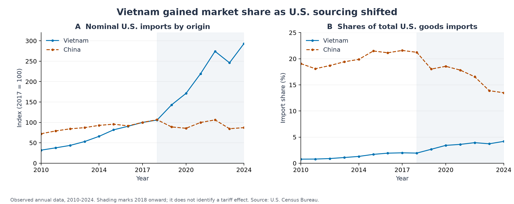
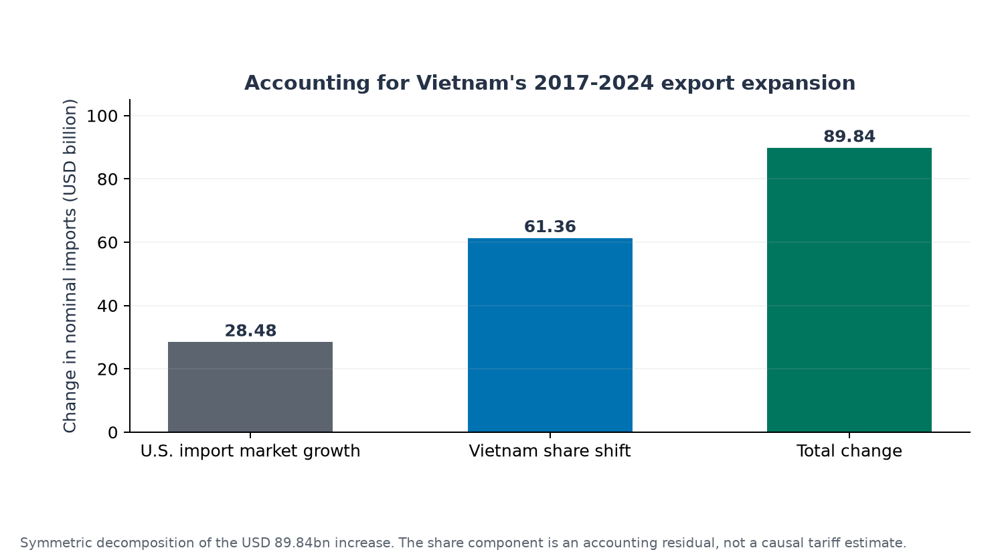
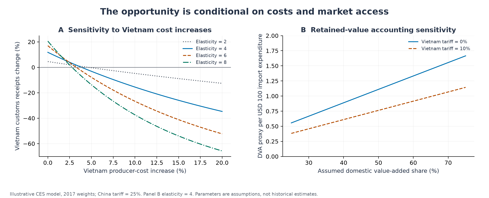
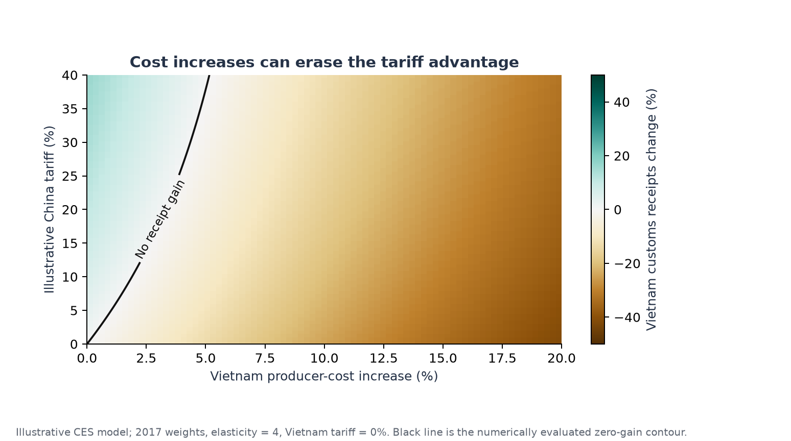

# 越南的贸易重配与国内价值获取

[English version](../en/report.md) · [方法](methods.md) · [证据审计](evidence-audit.md)

## 摘要

中美贸易摩擦期间越南出口的扩张提出了一个发展经济学问题：采购来源变化在何种条件下能够转化为持久的国内价值创造？本研究构建了 2010—2024 年美国与越南、中国及全球之间口径一致的年度商品贸易序列。2017—2024 年，美国自越南进口从 464.8 亿美元增至 1,363.2 亿美元，越南进口份额提高 2.19 个百分点。对称分解将其中 284.8 亿美元归入美国进口市场扩大项，613.6 亿美元归入越南份额变化项；两者均为会计核算结果。随后，三来源固定替代弹性模型在明确的假设下分离相对价格机制。使用 2017 年权重、替代弹性为 4、对中国征收 25% 假设关税时，越南海关价值收入增加 11.78%，但越南生产成本增加 3.86% 即可抵消该收益。因此，出口总额是不完整的发展指标。国内供应链联系、生产性投资、市场多元化和透明的原产地管理，共同决定出口机会能否促进长期升级与合作。

## 1. 研究问题与定位

针对大型供应者的贸易限制能够将采购转向第三国。第三国出口商可能获益，同时进口消费者承受更高价格，国际生产体系也可能更加碎片化。这些影响必须分别在双边贸易、国内收入和全球资源配置层面分析。

本报告讨论三个相互联系的问题：越南出口的实际扩张相对于美国整体进口市场有多大；针对中国的关税在何种成本与市场准入条件下能够提高越南收入；要将上述收益与产业升级及可持续发展目标 17 联系起来，还需要哪些证据。

本研究是描述性与机制性的分析，没有识别处理效应。其价值在于以一套可审计的框架区分实际贸易重配、算术分解和有条件的模型推论。虽然来源页面已经包含更晚年份，历史窗口仍固定为 2010—2024 年，以避免将原研究所讨论的阶段与后来的政策环境混在一起。

## 2. 经济机制与相关研究

[USTR 的第 301 条关税行动档案](https://ustr.gov/issue-areas/enforcement/section-301-investigations/tariff-actions)提供了政策背景。关税改变进口购买者面临的相对价格，却不会自动改变出口国的技术或要素禀赋。政策诱导的采购变化可能与比较优势相互重叠，但二者并非同一概念。

[Choi 与 Nguyen（2023）](https://doi.org/10.1111/1468-0106.12435)使用更细分的证据研究流向越南的贸易转移。[Dang、Krishna 与 Zhao（2023）](https://www.nber.org/papers/w31922)也研究了第三国反应及产品异质性。这些研究支持考察相对价格渠道；本仓库没有复刻其识别策略，也没有使用其估计系数。

四种机制可能同时发生：购买者在不搬迁工厂的情况下更换供应商；企业扩大现有越南工厂的产能；新增投资形成生产能力；商品经由第三国转运。是否合法符合原产地要求，取决于实际生产流程及适用规则。双边汇总数据既无法衡量各机制的比例，也不能证明违法行为。

要素禀赋理论有助于提出劳动密集型生产与装配活动的假说，但电子产品出口不直接等于国内技术能力。资本密度、进口零部件、任务内容与企业生产率需要分别度量。资本形成总额是投资流量，不能替代每名劳动者资本存量。

## 3. 数据与描述性设计

数据集包含美国与越南、中国以及所有国家之间的年度出口、进口和差额，共 45 条国家（地区汇总）—年份观测。[越南表](https://www.census.gov/foreign-trade/balance/c5520.html)、[中国表](https://www.census.gov/foreign-trade/balance/c5700.html)及[全球表](https://www.census.gov/foreign-trade/balance/c0015.html)均采用非季调、名义百万美元商品贸易口径。年度 TOTAL 行于 2026 年 11 月 6 日提取；归档保存的是页面表格行的提取结果，并非完整 HTML 镜像。

全文统一使用美国报告的自越南进口额。不能将其与越南报告的对美出口额直接拼接，因为估价、时间、覆盖范围及归属可能不同。世界其他地区的进口额由全球总额减去越南和中国得到；它是会计汇总，并不意味着这些供应者经济上同质。

描述性设计以 2017 年作为关税升级前的锚点，同时展示更早年份，并保留 2023 年的下滑，避免只选增长时期。所有金额均为名义值，变化可能同时反映价格、数量、产品结构和汇率。

## 4. 实际贸易重配

2017—2024 年，美国自越南进口增加 898.4 亿美元，累计增长 193.30%，年复合增长率为 16.62%。越南占美国商品进口份额从 1.99% 升至 4.18%，中国则从 21.59% 降至 13.49%。这些变化与采购转向越南的机制相一致，但不能证明越南逐一替代了中国生产。

越南的出口扩张也早于 2018 年。若把此后的全部增长都算作关税产生的新收益，就会忽视此前增长趋势。此外，美国自越南进口从 2022 年的 1,274.5 亿美元降至 2023 年的 1,143.8 亿美元，随后才回升至 2024 年的 1,363.2 亿美元。市场准入机会没有保证连续增长。

2024 年美国对越南商品贸易逆差为 1,232.5 亿美元。这是贸易核算差额，不能被解释为国民福利、双边债务、不公平程度或越南国内增加值。

## 5. 市场扩大能够解释多少增长？

将越南出口写为美国商品进口总额与越南份额的乘积，对称分解把二者的交互项均分给市场规模与份额变化。2017—2024 年，市场扩大对应 284.8 亿美元，占增长的 31.70%；份额变化对应 613.6 亿美元，占 68.30%。

份额变化项说明，越南并非仅按美国市场扩大比例增长。然而，它没有排除产业结构、既有投资、物流、汇率、疫情冲击和其他贸易安排的影响。将该项称为贸易战效应会超出研究设计的识别能力。

输出表同时报告 2010—2017、2017—2019、2019—2024、2020—2024 和 2022—2023 年窗口，说明单一基期选择不能替代研究设计。由公布总额计算的恒等式不附加统计显著性检验或置信区间。

## 6. 透明的机制实验

情景模型将固定的 100 美元含税进口支出分配给越南、中国及世界其他地区。模型采用 [Armington 的来源差异化思想](https://www.elibrary.imf.org/view/journals/024/1969/001/article-A007-en.xml)、标准化基准价格与实际支出权重。替代弹性和关税楔子均为假设，并非估计值。

基准情景中，对中国施加 25% 假设关税，使越南海关价值收入增加 11.78%。越南支出份额从 1.99% 升至 2.22%，进口组合价格指数提高 3.78%，固定预算下实际进口组合减少 3.64%。每 100 美元支出产生 2.47 美元关税收入；该项单独核算，没有假定返还后重新进入需求。

这些结果说明，第三国收入增加能够与进口购买者购买力下降同时出现。但它们不是国家或全球福利估计：模型没有美国国内生产、报复关税、要素收入、投资、汇率及投入产出网络。

越南生产成本提高 3.86% 即可抵消基准收入收益。若成本提高 5%，即便中国仍面对关税，越南收入也比标准化基准低 3.15%。该阈值较小，是因为越南面对的是全部未被征税供应者的竞争，而不只是中国。它依赖特定校准，并不估计越南实际产能瓶颈。

情景网格改变校准年份（2017、2019、2024）、替代弹性（2、4、6、8）、中国关税（0%、10%、25%）、越南关税（0%、10%）、越南成本乘数（1、1.05、1.10、1.20）及假设国内增加值比例（25%、50%、75%）。288 组配置在保留价值假设下形成 864 条记录。这是有组织的敏感性分析，并非概率分布。

## 7. 从出口收入到国内价值获取

保留价值代理量以越南海关价值收入乘以假定国内增加值比例，将总销售机会与本地价值创造区分开来。它不衡量国民可支配收入、外资利润汇回、环境损害、机会成本，也没有刻画工资和利润的分配。

即便市场准入是动机之一，投资仍可能形成新增资本、就业、培训和供应商需求。因此，缺乏更多证据时，不能把迁移认定为完全零和或没有真实经济内容。反过来，外资实际到位额增长本身也不能证明国内溢出效应。判断生产联系，需要本地采购、技术协助、工资变化和国内企业生产率数据。

[世界银行的《越南 2045》报告](https://www.worldbank.org/en/country/vietnam/publication/viet-nam-2045-trading-up-in-a-changing-world)将国内供应商联系、技能、服务业、更深的贸易融合和韧性生产列为重点。这些机构证据支持研究升级约束，但不能验证原材料中的每一项数值。本项目没有估计外资效应，也没有继续使用尚未核实的外资和生产率序列。

## 8. SDG 17 与政策解释

[联合国的具体目标](https://sdgs.un.org/goals/goal17)构成合作评价框架，而非本研究估计的因果指数。17.10 涉及多边贸易体系，17.3 涉及金融资源动员，17.6 和 17.9 涉及合作与能力建设。17.5 的文字具体针对最不发达国家的投资促进制度，不宜直接当作适用于越南的通用外资目标。

这一框架提出三项评价标准：市场准入是否足够可预期以支持生产性投资；新增出口活动是否增强国内供应能力，而非永久依赖有利关税差；原产地管理能否依据实际加工区分真实转化与没有证据的指控，并减少不必要的贸易摩擦。

供应商发展、劳动者技能、可靠基础设施、出口市场多元化和透明海关程序对应上述标准。这些是基于机制与机构证据提出的优先方向，没有作为政策干预接受实证评估。环境和分配结果也应纳入后续评价。

“贸易战在任何条件下都无法被正当化”不能由双边总额直接推出。安全目标、市场势力或外部性论证需要明确目标、替代工具、报复措施与动态效应。本研究支持较窄的结论：第三国出口获益不足以证明贸易冲突改善总体福利或国际合作。

## 9. 局限与可实施的实证拓展

年度汇总数据无法识别关税暴露、产品替代、国内增加值、企业迁移或规避行为。CES 模型假定可分离需求与恒定替代弹性，把世界其他地区视为一个来源，抽象掉原有关税，没有内生求解供给或投资决策。国内增加值比例是外生的；改变比例并不等于模拟升级成本。

更强的因果研究需要整合美国 HS 产品—来源国月度进口、各轮关税生效日期及豁免、单位价值，以及越南生产和投入数据。可用事件时间交互项与合适的来源、产品及时间控制，比较不同产品暴露。还需要前趋势检查、预期窗口、商品编码转换、聚类不确定性和安慰剂结果检验。由于贸易转移本身影响对照国家，未经处理来源的共同趋势假设尤其严格。该设计仅为建议，尚未执行。

## 10. 结论

越南实际市场份额提升幅度明显，在扣除美国整体市场扩大后仍然成立。但增长原因及其国内发展价值，不能直接从出口总额读取。已实现的机制实验表明，相对价格机会可能被较小成本上升或针对越南的新关税逆转。因此，持续升级需要出口增长之外的生产率、国内联系及韧性市场准入证据。
